# JAS ACADEMY — архитектура (1-кезең)

## 1. Шешім: технология

Master prompt-та Next.js + PostgreSQL жазылған. Жоба иесі оны өзгертті: **таза PHP, besb.c стилінде**.
Сондықтан:

| Талап | Master prompt | Қабылданған шешім | Себебі |
|---|---|---|---|
| Frontend | Next.js, shadcn/ui | PHP беттер + jQuery + norm.css | Иесінің стилі (besb.c, aruacademy.c) |
| DB | PostgreSQL | MySQL / MariaDB (OSPanel) | Иесінің серверлері MySQL |
| Auth | Supabase Auth | Өз сессиясы: `password_hash`, HttpOnly cookie, `session_regenerate_id`, CSRF | Supabase аймағы ҚР емес; сервер-сайд тексеру |
| RLS | PostgreSQL RLS | `fun::scope()` + әр сұраныста `organization_id` | MySQL-да RLS жоқ |
| ID | UUID | `int unsigned AUTO_INCREMENT` | Иесінің стилі. ID жасырын емес, сондықтан әр бетте рұқсат серверде тексеріледі |
| API | `/api/v1/participants` | `/participants/get.php?add` (иесінің стилі) | Кейін `/api/v1/` мобильді қосымша үшін бөлек қосылады |
| Тест | Vitest + Playwright | `php tests/run.php` (50 тест, HTTP қоса) | Node қажет емес |

## 2. Қайшылықтар және бекітілмеген сұрақтар

1. **«Абонемент мерзімі — алғашқы расталған төлемнен 1 ай»** + **«ішінара төлем»**: ішінара төлем де «расталған төлем» ме? Қазір: кез келген расталған төлем (ішінара болса да) мерзімді бастайды. Растау керек.
2. **Заморозка 7 күн**: заморозка күндері `end_date`-ті ұзарта ма? Схема `freezes.days` сақтайды; ұзарту — 1-кезеңнің келесі қадамы (Subscriptions модулі). Растау керек.
3. **Жаттығу лимиті тек келген жаттығулар**: «себепті келмеді» лимиттен кемімейді деп қабылданды.
4. **Қатарынан 5/10 жаттығу**: «себепті» немесе «заморозка» серияны үзе ме? Ұсыныс: үзбейді, бірақ санамайды.
5. **Ай бойы 100%**: айда кемінде қанша жаттығу болуы керек? Ұсыныс: кемінде 8.
6. **Kaspi RED комиссиясы** — шығын ретінде ме, әлде қатысушыға қосыла ма? Қазір: академия шығыны (`payments.fee_amount`), таза нәтижеден шегеріледі.
7. **Ересек футболшы + ата-ана** — 16–17 жастағылар қай бағытта? Қазір бағытты әкімші қолмен таңдайды.
8. **Hosting**: нақты қатысушылар деректерін ҚР-дағы серверге ғана жүктеу. gprog.kz хостингінің ДЦ орны тексерілуі керек.
9. **Instagram / TikTok LIVE**: ресми embed API жоқ — тек сыртқы сілтеме. YouTube Live — iframe арқылы ендіріледі.
10. **Видео сақтау**: үлкен видеоны PHP хостингке жүктеу дұрыс емес. Object storage (ҚР-дағы S3-үйлесімді, мысалы PS Cloud / Kazteleport) таңдау керек. Схемада `storage_key` дайын.

## 3. Жүйе архитектурасы

```
Браузер (телефон / компьютер)
   │  HTML беттер + jQuery $.ajax (X-CSRF-Token)
   ▼
Apache + PHP 7.4/8.x  (OSPanel / хостинг)
   ├─ config/core.php   сессия, auth, рөлдер, CSRF, $site, $lang
   ├─ config/db.php     mysqli prepared statements, db::tx()
   ├─ config/fun.php    scope(), қарыз, жас, туған күн, audit, upload
   ├─ <модуль>/index.php  бет (сервер рендер)
   └─ <модуль>/get.php    әрекеттер (POST, JSON)
   ▼
MySQL / MariaDB (utf8mb4, InnoDB, FK)
   └─ assets/uploads → кейін Object Storage
```

**Қауіпсіздік қабаттары**
- Әр бет: `core::need_page([...рөлдер])`; әр әрекет: `core::need([...])`.
- Қатысушы деректері: `fun::scope()` — бапкер тек өз тобын, ата-ана тек өз балаларын, қатысушы тек өзін көреді. `fun::participant($id)` басқа баланы `null` қайтарады → 404.
- Барлық сұраныс prepared statement. HTML шығару `h()` арқылы.
- Құпия сөз `password_hash`, cookie-де тек сессия ID. 15 минутта 5 қате → бөгеу.
- Төлем өшірілмейді: `reversal_of_id` (UNIQUE), `idempotency_key` (UNIQUE), `external_ref` (UNIQUE).
- Рейтинг қайталанбайды: `UNIQUE(participant_id, rule, source_type, source_id)`.
- Қатысу қайталанбайды: `UNIQUE(session_id, participant_id)`.
- Барлық өзгеріс `audit_logs`-ке.
- `config/ sql/ tests/ tools/ docs/` браузерден жабық (.htaccess), uploads ішінде PHP орындалмайды.

## 4. ERD

```mermaid
erDiagram
  organizations ||--o{ memberships : ""
  users ||--o{ memberships : "рөл"
  organizations ||--o{ participants : ""
  users |o--o| participants : "ересек аккаунты"
  participants ||--o{ participant_guardians : ""
  guardians ||--o{ participant_guardians : ""
  users |o--o{ guardians : "ата-ана кабинеті"
  venues ||--o{ groups : ""
  users ||--o{ groups : "бапкер"
  groups ||--o{ enrollments : ""
  participants ||--o{ enrollments : "топ тарихы"
  groups ||--o{ schedule_templates : ""
  schedule_templates ||--o{ sessions : ""
  sessions ||--o{ attendance : ""
  participants ||--o{ attendance : ""
  plans ||--o{ subscriptions : ""
  participants ||--o{ subscriptions : ""
  subscriptions ||--o{ freezes : ""
  subscriptions ||--o{ invoices : ""
  participants ||--o{ payments : ""
  payments ||--o{ payment_allocations : ""
  subscriptions ||--o{ payment_allocations : ""
  payments |o--o| payments : "reversal_of"
  participants ||--o{ rating_events : ""
  achievements ||--o{ participant_achievements : ""
  participants ||--o{ participant_achievements : ""
  participants ||--o{ player_assessments : ""
  player_assessments ||--o{ assessment_scores : ""
  assessment_criteria ||--o{ assessment_scores : ""
  teams ||--o{ team_rosters : ""
  participants ||--o{ team_rosters : ""
  competitions ||--o{ matches : ""
  opponents ||--o{ matches : ""
  matches ||--o{ match_player_stats : ""
  selection_campaigns ||--o{ selection_candidates : ""
  participants ||--o{ selection_candidates : ""
  media_albums ||--o{ media_assets : ""
  media_assets ||--o{ media_asset_participants : ""
  participants ||--o{ media_consents : ""
  training_lessons ||--o{ training_assignments : ""
  training_assignments ||--o{ assignment_submissions : ""
  campaigns ||--o{ leads : ""
  matches ||--o{ live_streams : ""
  users ||--o{ notifications : ""
```



Толық схема: `sql/001_schema.sql` (48 кесте).

## 5. Қарыз формуласы

```
қарыз(абонемент) = max(0, price − discount − Σ allocation(расталған төлемдер))
```
Reversal / refund — теріс allocation, сондықтан қарыз автоматты қайта өседі. `pending` төлем қарызды азайтпайды.
SQL: `fun::debt_sql()`.

## 6. Endpoint спецификациясы (1-кезең)

Барлық POST: `X-CSRF-Token` header (немесе `csrf` өрісі). Жауап: JSON `{ok, id?, errors?, mess?}`.
Қате кодтар: `401 sign` (кірмеген), `403 right` (рөл жоқ), `419 csrf`.

| Әдіс | URL | Рөл | Не істейді |
|---|---|---|---|
| POST | `/sign/get.php?sign_in` | — | phone, password → `yes` / `none` / `limit` |
| GET | `/exit.php` | кірген | шығу |
| GET | `/dashboard/` | owner, admin, coach | көрсеткіштер (coach — қаржысыз, өз топтары) |
| GET | `/participants/?q=&dir=&group=&st=&debt=&page=` | барлығы (scope) | тізім, іздеу, сүзгі |
| GET | `/participants/item.php?id=` | барлығы (scope) | профиль, 9 бөлім |
| POST | `/participants/get.php?add` | owner, admin | қатысушы + топ + ата-ана (транзакция) |
| POST | `/participants/get.php?edit` | owner, admin | профильді өңдеу |
| POST | `/participants/get.php?set_group` | owner, admin | id, group_id, reason — тарих сақталады |
| POST | `/participants/get.php?guardian_add` | owner, admin | ата-ана қосу |
| POST | `/participants/get.php?archive` / `restore` | owner, admin | өшірмейді, архивке |
| POST | `/participants/get.php?img` | owner, admin | фото (jpg/png/webp, 5 МБ) |
| GET | `/groups/` | owner, admin, coach | топтар |
| POST | `/groups/get.php?add` | owner, admin | топ қосу |
| GET | `/schedule/?v=week\|month&d=&group=&coach=` | барлығы (scope) | кесте, шаблоннан жаттығу генерациясы |
| POST | `/schedule/get.php?session_add` / `session_move` / `session_cancel` | owner, admin, coach (өз тобы) | қақтығыс тексеріледі, ата-аналарға хабарлама |
| POST | `/schedule/get.php?tpl_add` / `tpl_stop` | owner, admin | тұрақты кесте |
| GET | `/attendance/?d=`, `/attendance/session.php?id=` | owner, admin, coach (өз тобы) | телефоннан белгілеу |
| POST | `/attendance/get.php?mark` | owner, admin, coach | id, marks[pid]=present/absent/excused/frozen → rating_sync |
| GET | `/subscriptions/?st=&dir=&q=` | owner, admin | абонементтер, заморозка өтініштері, тарифтер |
| POST | `/subscriptions/get.php?sell` / `cancel` / `freeze_add` / `freeze_decide` / `plan_add` / `plan_fee` | owner, admin | |
| GET | `/payments/?m=&st=&method=&q=&add=` | owner, admin | төлемдер, айлық есеп, шығындар |
| POST | `/payments/get.php?subs` / `add` / `confirm` / `reject` / `reverse` / `expense_add` | owner, admin | idempotency_key, row lock, артық төлем жоқ, сторно |
| GET | `/rating/?s=kids\|adult&t=month\|discipline\|all&m=` | барлығы (ата-ана/қатысушы — тек өз орны) | |
| POST | `/rating/get.php?award` / `progress` / `manual` / `revoke` | coach (өз тобы), manual/revoke — owner, admin | |
| GET | `/first_team/`, `/first_team/match.php?id=` | owner, admin, coach, participant (оқу) | |
| POST | `/first_team/get.php?team_add` / `roster_add` / `roster_remove` / `match_add` / `match_save` | owner, admin, coach | матч абонемент лимитіне әсер етпейді |
| GET/POST | `/progress/`, `item.php?id=`, `get.php?add` | барлығы оқиды (scope), бағалау — owner, admin, coach | 1–10, ≥3 көрсеткіш, орташа өссе +20 (айына 1) |
| GET/POST | `/scouting/`, `get.php?campaign_add` / `campaign_status` / `candidate_add` / `candidate_status` | owner, admin, coach | accepted (first_team, adult) → құрамға |
| GET/POST | `/cabinet/`, `get.php?freeze_request` | parent, participant | өз балалары ғана, requested → әкімшіге хабарлама |
| GET/POST | `/media/`, `file.php?id=`, `get.php?album_add` / `upload` / `delete` / `consent` | барлығы көреді (visibility), жүктеу — staff | келісімсіз белгілеу бөгеледі, `assets/uploads/media/` тікелей жабық |
| GET/POST | `/training/`, `get.php?lesson_add` / `assign` / `submit` / `review` | барлығы | тапсыру — тек өз тобы/өзі |
| GET/POST | `/live/`, `get.php?add` / `status` | оқу — барлығы, қосу — staff | тек https YouTube/Instagram/TikTok |
| GET/POST | `/crm/`, `get.php?lead_add` / `lead_status` / `campaign_add` / `content_add` / `content_status` | owner, admin | бір нөмірден бір белсенді өтінім |
| GET/POST | `/notifications/`, `get.php?read` / `read_all` | барлығы (тек өзінікі) | notify_daily: туған күн, абонемент бітуі (dedupe) |
| GET | `/reports/?y=&csv=finance\|debtors\|attendance` | owner, admin | CSV (Excel BOM), экспорт audit-та |

## 7. Файл құрылымы

```
jas.c/
├─ index.php, exit.php, 404.php, .htaccess
├─ config/   core.php db.php fun.php t.php db.local.example.php
├─ block/    head header menu footer modal pagination 403
├─ sign/     index.php get.php
├─ dashboard/index.php
├─ participants/  index.php item.php form.php get.php
├─ groups/   index.php get.php
├─ schedule/ attendance/ subscriptions/ payments/ rating/ first_team/  (index.php + get.php)
├─ progress/ scouting/ cabinet/ media/ training/ live/ crm/ notifications/ reports/
├─ config/academy.php  — кесте, рейтинг, абонемент, төлем ережелері
├─ assets/   css/(norm main sign) js/(norm fun main sign participants groups) pl/ img/ uploads/
├─ sql/      001_schema.sql
├─ tools/    migrate.php seed.php students_to_participants.php
├─ tests/    run.php router.php
└─ docs/     ARCHITECTURE.md
```
Жаңа модуль = жаңа папка (`schedule/index.php` + `schedule/get.php`), мәзірге `block/menu.php`-та сілтеме.

## 8. Кезеңдер және acceptance criteria

**Phase 1 — Core MVP**
- [x] Схема, миграция, seed — `php tools/migrate.php` қатесіз, 48 кесте
- [x] Auth + 5 рөл, серверлік тексеру, CSRF, brute-force
- [x] Dashboard — барлық сан DB-дан, coach қаржыны көрмейді
- [x] Participants — тізім/іздеу/сүзгі/пагинация, профиль, қосу/өңдеу/архив, топ ауысу тарихы, фото, ата-ана, audit
- [x] Groups — тізім, қосу
- [x] Schedule — апта/ай күнтізбесі, шаблоннан sessions генерациясы, болдырмау/ауыстыру, алаң/бапкер қақтығысы
- [x] Attendance — бапкер телефоннан белгілейді, +10 ұпай автоматты, өзгерсе ұпай түзетіледі
- [x] Subscriptions — сату, 1 ай, лимит, қалған жаттығу
- [x] Payments — қолмен енгізу, растау, reversal, RED комиссия, idempotency
- [x] Freezes — сұраныс, 7 күн лимит, растау

- [x] JAS Rating — айлық / тәртіп / All-Time, KIDS және ADULT бөлек, серия 5/10, 100% ай, марапат, прогресс
- [x] First Team & ЛЛФ — құрам, матчтар, нәтиже, футболшы статистикасы, MVP, бомбардирлер

**Phase 2–3**
- [x] Player progress — бағалау, график, көрсеткіштер, +20 прогресс ұпайы
- [x] Parent / Participant кабинеті — келесі жаттығу, абонемент, қарыз, рейтинг, заморозка өтініші
- [x] Scouting — кампания, kanban, accepted → First Team
- [x] Media — альбом, фото (жабық сақтау), YouTube, ата-ана келісімі
- [x] Training Hub — сабақтар, үй тапсырмасы, тексеру
- [x] JAS Live — YouTube эфир, басталғанда хабарлама
- [x] Marketing CRM — өтінімдер, кампаниялар (CPL), контент жоспары
- [x] Notifications — ішкі хабарламалар (кейін WhatsApp)
- [x] Reports — 12 ай қаржы, бағыт/тәсіл/санат, қатысу, қарыз, конверсия, CSV

Кейін: Object Storage (қазір фото серверде), WhatsApp хабарлама, Kaspi интеграциясы.
